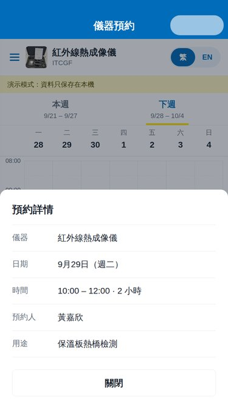

# 可持續發展建材實驗室 · 儀器預約小程序

澳門科技大學可持續發展建材實驗室的微信小程序，用來預約實驗室儀器。介面支援**繁體中文**和 **English**，配色取自澳科大校徽（藍色＋金色）。

| 首頁 | 選擇儀器 | 選擇時段 | 預約詳情 | 確認預約 | English |
| --- | --- | --- | --- | --- | --- |
|  |  |  |  |  |  |

（以上是測試工具渲染的預覽圖，實際效果以微信開發者工具為準。）

## 功能

- **首頁**：澳科大 logo、實驗室名稱，中間一個按鈕進入「實驗室儀器預約系統」；右上角切換 繁 / EN。
- **側邊欄選擇儀器**：23 台儀器（《儀器清單_2026-09-03》中黑色字的儀器），附照片、型號、地點，可搜尋中英文名稱、型號、地點。
- **週曆**：可切換「本週 / 下週」，顯示每台儀器的佔用時段，以及預約人姓名和用途；點擊預約可看詳情。
- **預約**：點擊空白格子（每格 30 分鐘）選擇時間，拖動上下圓點調整時長 → 填寫姓名、用途 → 確定預約 → 提示「預約成功」後回到週曆。
- **取消**：自己的預約（金色）可在詳情中取消；管理員可取消任何人的預約。
- 已過去的時段顯示灰色，紅線表示現在時間；時間一律以澳門時間（UTC+8）計算。
- 兩人同時預約同一時段時，由雲函數在數據庫交易中檢查，後提交的一方會收到「該時段剛被其他人預約」；同時預約不同時段則都會成功。

## 快速開始（演示模式）

1. 安裝[微信開發者工具](https://developers.weixin.qq.com/miniprogram/dev/devtools/download.html)。
2. 「導入項目」，選擇本倉庫的根目錄（有 `project.config.json` 的目錄）。AppID 可先用測試號。
3. 編譯即可使用。

`miniprogram/config.js` 裡 `cloudEnv` 留空時是**演示模式**：預約只保存在本機，並附帶幾條示範預約，頁面頂部會顯示黃色提示條。

## 正式使用（微信雲開發）

所有人共用同一份預約資料需要雲開發：

1. 在 `project.config.json` 把 `appid` 改成實驗室小程序的 AppID。
2. 開發者工具 →「雲開發」→ 開通，建立一個環境，複製**環境 ID**。
   注意：雲開發是付費服務。開發階段可以用免費／體驗環境，但小程序發布後免費環境只保留一段短時間（以微信「雲開發 → 計費說明」及免費體驗活動公告為準），
   請在到期前升級為付費套餐並開啟自動續費，否則預約功能會停止運作。
3. 把環境 ID 填入 `miniprogram/config.js`：
   ```js
   cloudEnv: 'your-env-id',
   ```
4. 在開發者工具左側右鍵 `cloudfunctions/booking` →「上傳並部署：雲端安裝依賴」。
   （`cloudfunctions/booking/config.json` 把超時時間設為 10 秒；如控制台顯示的仍是 3 秒，可在雲函數的「版本與配置」中修改。）
5. 雲開發控制台 →「數據庫」→ 新建集合 `schedules`（第一次預約時也會自動建立），
   權限設定選「自定義安全規則」並填入：
   ```json
   { "read": false, "write": false }
   ```
   所有讀寫都經過雲函數，用戶端不能直接改資料。
6. （可選）設定管理員：在 `cloudfunctions/booking/settings.js` 的 `ADMIN_OPENIDS` 填入管理員的 openid，重新部署雲函數。
   openid 可在數據庫 `schedules` 中管理員自己預約那一條的 `openid` 欄位找到。
7. 上傳代碼、提交審核。小程序會收集用戶自行填寫的姓名和用途，請在公眾平台的「用戶隱私保護指引」中說明。

任何打開小程序的微信用戶都可以預約，並看到預約人姓名和用途。`sitemap.json` 已設定不讓頁面內容被微信搜尋收錄；如只給實驗室成員使用，
可在公眾平台的設定中關閉「允許被搜尋」，改為把小程序分享給成員。管理員可在預約詳情中取消任何人的預約。

雲函數預設會用微信內容安全接口（`security.msgSecCheck`）檢查姓名和用途；如不需要，把 `settings.js` 裡的 `CONTENT_CHECK` 改為 `false`。

## 常見修改

| 想修改 | 位置 |
| --- | --- |
| 儀器清單、名稱、型號、地點 | `miniprogram/data/instruments.js`，照片放在 `miniprogram/images/instruments/<id>.jpg` |
| 可預約時間（預設 08:00–22:00）、每格時長、姓名/用途字數上限 | `miniprogram/utils/booking-core.js` 頂部的常數 |
| 介面文字 | `miniprogram/i18n/zh.js`、`miniprogram/i18n/en.js` |
| 顏色 | `miniprogram/app.wxss` 頂部的顏色變量；導航欄藍色另見 `pages/booking/booking.json`、`pages/confirm/confirm.json` 的 `navigationBarBackgroundColor`，取消對話框按鈕色見 `pages/booking/booking.js` 的 `confirmColor` |
| 校徽圖片 | `miniprogram/images/must-logo.png`（目前由提供的截圖放大，略有模糊，建議換成學校提供的高清 PNG，四周留少量透明邊） |

修改 `instruments.js` 或 `booking-core.js` 後，執行 `npm run sync`，再重新部署 `booking` 雲函數，雲函數才會使用新的儀器清單和規則。
儀器的 `id` 會存進每條預約，已有的 `id` 請不要更改。

## 資料結構

集合 `schedules`，每台儀器每天一份文件：

```js
{
  _id: 'centrifuge_2026-09-28',   // <儀器 id>_<日期>
  instrumentId: 'centrifuge',
  date: '2026-09-28',
  bookings: [
    { id, startMin: 600, endMin: 660, name: '陳大文', purpose: '…', openid, createdAt }
  ],
  cancelled: [ /* 已取消的預約，另加 cancelledAt、cancelledBy */ ],
  updatedAt
}
```

`startMin` / `endMin` 是當天的分鐘數（600 = 10:00）。把一天的預約放在同一份文件裡，雲函數才能在一個交易中檢查重疊並寫入；
遇到交易衝突會自動重試。每次預約帶一個 `requestId`，網絡不穩重試時不會重複預約。

## 目錄

```
miniprogram/
  pages/index        首頁
  pages/booking      預約系統（側邊欄 + 週曆）
  pages/confirm      填寫姓名、用途並確認
  components/        week-calendar、instrument-drawer、booking-detail、lang-switch
  utils/booking-core.js  預約規則（與雲函數共用）
  services/          呼叫雲函數；演示模式的本機儲存
  data/instruments.js    儀器清單
  i18n/              繁體中文、English
cloudfunctions/booking/  雲函數（list / create / cancel）
tests/               自動化測試
```

## 開發與測試

```bash
npm install
npm test
```

測試用 [miniprogram-simulate](https://github.com/wechat-miniprogram/miniprogram-simulate) 和微信官方 WXML 編譯器渲染頁面，覆蓋預約規則、雲函數（包括同時預約、交易衝突重試）、週曆的點擊、拖動和自動捲動、不同螢幕寬度下的對齊，以及從選擇儀器到預約、取消的完整流程。

## 備註

- 儀器名稱根據資產清單整理：「健恒電位儀 … Bipotentiostat CS2350M」寫作「雙恆電位儀」；3D 印表機的型號 Raise3D E2 取自照片；兩台相同的通風櫃、磁力攪拌器、超聲波清洗機以 1、2 區分。如有不準確，在 `instruments.js` 修改名稱即可（不要改 `id`）。
- 英文實驗室名稱暫定為 Sustainable Building Materials Laboratory，可在 `i18n` 文件中修改。
