# 可持續發展建材實驗室 · 儀器預約小程序

澳門科技大學可持續發展建材實驗室的微信小程序，用來預約實驗室儀器。介面支援**繁體中文**和 **English**，配色取自澳科大校徽（藍色＋金色）。

| 首頁 | 選擇登入方式 | 用戶登入 | 管理員登入 |
| --- | --- | --- | --- |
| 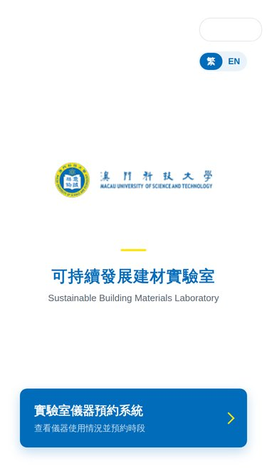 | 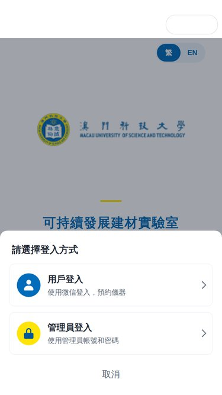 | 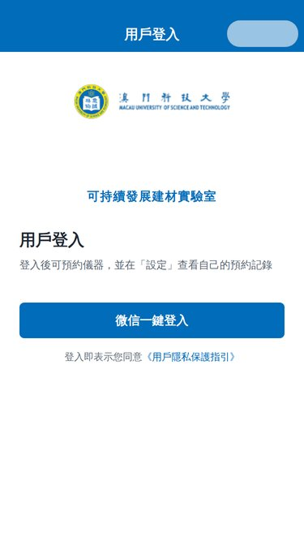 | 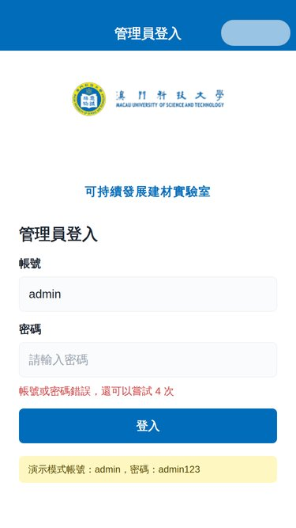 |

| 選擇儀器 | 選擇時段 | 確認預約 | 設定：我的預約 |
| --- | --- | --- | --- |
| 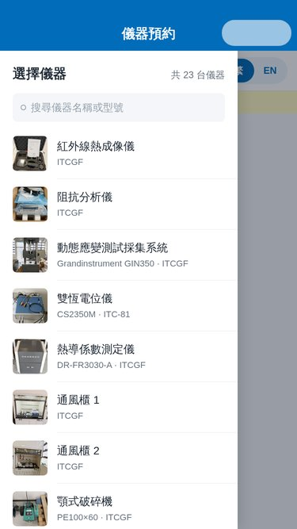 | 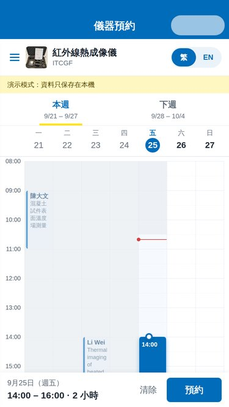 | 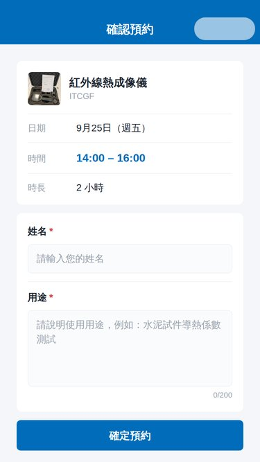 | 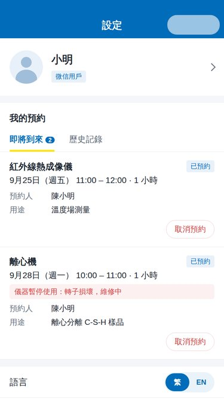 |

| 管理員：預約詳情 | 管理員：預約管理 | 暫停預約 | English |
| --- | --- | --- | --- |
| 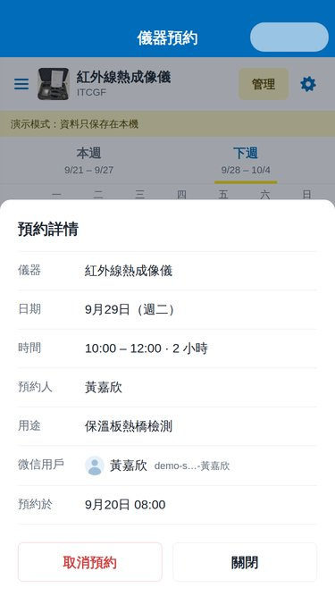 | 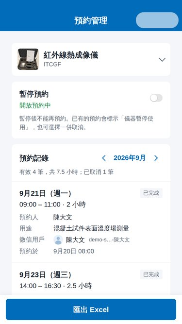 | 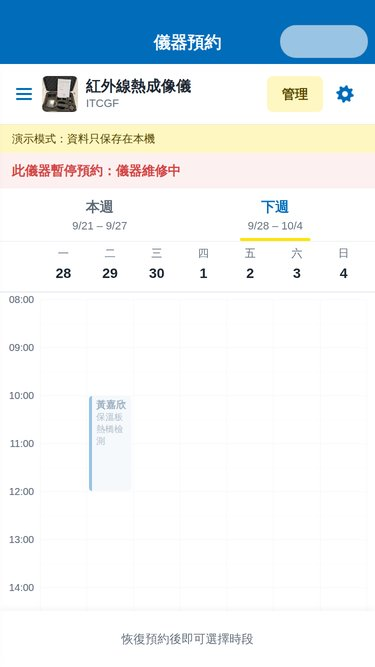 | 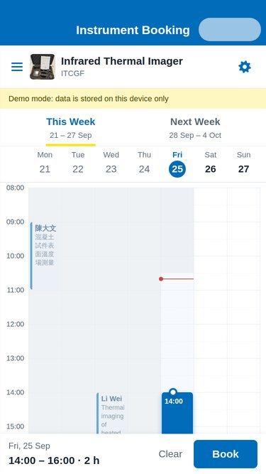 |

（以上是測試工具渲染的預覽圖，實際效果以微信開發者工具為準。）

## 功能

- **首頁**：澳科大 logo、實驗室名稱，中間一個按鈕進入「實驗室儀器預約系統」；右上角切換 繁 / EN。
- **登入**：未登入時點按鈕會跳出兩個選項：
  - **用戶登入**：微信一鍵登入；第一次登入時設定頭像和暱稱（管理員會看到，之後可在「設定」修改）。
  - **管理員登入**：帳號＋密碼。連續輸錯 5 次，該微信帳號會被鎖定 15 分鐘；登入有效期 7 天。
  - 已用微信登入後，按鈕直接進入預約系統；按鈕下方的「管理員登入」可隨時切換為管理員。
- **側邊欄選擇儀器**：23 台儀器（《儀器清單_2026-09-03》中黑色字的儀器），附照片、型號、地點，可搜尋；暫停預約的儀器有標示。
- **週曆**：本週 / 下週，顯示每台儀器的佔用時段、預約人姓名和用途。
- **預約**：點擊空白格子（每格 30 分鐘）選擇時間，拖動上下圓點調整時長 → 填寫姓名、用途 → 確定預約 → 「預約成功」後回到週曆。
- **設定**（右上角齒輪）：頭像、暱稱、身份（點擊可修改頭像和暱稱）；**我的預約**（即將到來 / 歷史記錄，可取消即將到來的預約）；語言；管理員入口；登出。
- **管理員**：
  - 週曆中點擊任何預約，可看到是哪個**微信用戶**（暱稱、頭像、微信用戶 ID）、用的什麼名字、用途、時間和預約時間，並可取消。
  - **預約管理**頁（週曆右上角「管理」或 設定 → 預約管理）：按月份查看某儀器的全部預約記錄（包括已取消的、由誰取消）；
    **匯出 Excel**（本月或全部記錄，可轉發或保存）；**暫停預約**（例如儀器壞了，可填原因），恢復時關閉開關即可。
  - 暫停後，已有的預約在預約人的「我的預約」中標示「儀器暫停使用」；管理員可選擇把尚未結束的預約**一併取消**，預約人會看到取消原因。
- 已過去的時段顯示灰色，紅線表示現在時間；時間一律以澳門時間（UTC+8）計算。
- 兩人同時預約同一時段時，由雲函數在數據庫交易中檢查，後提交的一方會收到「該時段剛被其他人預約」。

## 快速開始（演示模式）

1. 安裝[微信開發者工具](https://developers.weixin.qq.com/miniprogram/dev/devtools/download.html)。
2. 「導入項目」，選擇本倉庫的根目錄（有 `project.config.json` 的目錄）。AppID 可先用測試號。
3. 編譯即可使用。

`miniprogram/config.js` 裡 `cloudEnv` 留空時是**演示模式**：資料只保存在本機，附帶幾條示範預約，頁面頂部會顯示黃色提示條。
演示模式的管理員帳號是 `admin`，密碼 `admin123`（只在演示模式有效）。

## 正式使用（微信雲開發）

所有人共用同一份預約資料需要雲開發：

1. 在 `project.config.json` 把 `appid` 改成實驗室小程序的 AppID。
2. 開發者工具 →「雲開發」→ 開通，建立一個環境，複製**環境 ID**。
   注意：雲開發是付費服務。開發階段可以用免費／體驗環境，但小程序發布後免費環境只保留一段短時間（以微信「雲開發 → 計費說明」及免費體驗活動公告為準），
   請在到期前升級為付費套餐並開啟自動續費，否則預約功能會停止運作。
3. 把環境 ID 填入 `miniprogram/config.js`：
   ```js
   cloudEnv: 'your-env-id',
   ```
4. **設定管理員帳號**：在本倉庫根目錄執行（需要 Node.js；Windows 的命令提示字元、PowerShell 和 macOS / Linux 終端都可以）：
   ```bash
   node scripts/hash-password.js
   ```
   按提示輸入兩次密碼（至少 12 個字元；輸入時不會顯示，也不會留在命令記錄中），把輸出的一行填入 `cloudfunctions/booking/settings.js`：
   ```js
   ADMIN_ACCOUNTS: [
     { account: 'admin', passwordHash: 'pbkdf2_sha256$600000$...' }
   ],
   ```
   可以設多個帳號。代碼中只保存密碼的雜湊值，不保存密碼本身。
   **撤銷管理員**：刪除該帳號或換一個新密碼（重新產生雜湊），再重新部署雲函數；用舊帳號或舊密碼登入的所有人會立即失去管理員權限。
5. 在開發者工具左側右鍵 `cloudfunctions/booking` →「上傳並部署：雲端安裝依賴」。
   （`cloudfunctions/booking/config.json` 把超時時間設為 10 秒；如控制台顯示的仍是 3 秒，可在雲函數的「版本與配置」中修改。）
6. **（重要）數據庫權限**：雲開發控制台 →「數據庫」，**在小程序開始使用前**手動建立以下 4 個集合，
   並把每個集合的權限都改為「自定義安全規則」，填入 `{ "read": false, "write": false }`（所有讀寫都經過雲函數）。
   如果先使用、讓雲函數自動建立集合，集合會是預設的「僅創建者可讀寫」，小程序用戶可以直接寫入資料，請記得回來修改。
   （雲函數會忽略所有由小程序直接寫入的文件，所以即使忘記修改，也不能藉此取得管理員權限或偽造預約。）

   | 集合 | 內容 | 建議索引 |
   | --- | --- | --- |
   | `schedules` | 每台儀器每天一份文件，用來檢查時段重疊 | — |
   | `bookings` | 每個預約一條記錄（包括已取消的） | `openid` 升序；`instrumentId` 升序 + `date` 升序 |
   | `users` | 微信用戶的暱稱、頭像、管理員登入狀態 | — |
   | `instrument_status` | 儀器是否暫停預約及原因 | — |

7. **雲存儲**用來保存用戶頭像（`avatars/`）和匯出的 Excel（`exports/`）。使用默認權限（所有用戶可讀）即可：
   匯出的檔案名是隨機的 32 位字元，小程序下載後會立即刪除雲端的那一份（未能刪除時，下次匯出或登出時也會刪除）。
8. 在公眾平台填寫「**用戶隱私保護指引**」：小程序會收集用戶的**微信暱稱、頭像**，以及用戶自行填寫的**姓名和預約用途**。
   未填寫時，頭像和暱稱無法使用。
9. 上傳代碼、提交審核。

`sitemap.json` 已設定不讓頁面內容被微信搜尋收錄。如只給實驗室成員使用，可在公眾平台的設定中關閉「允許被搜尋」，改為把小程序分享給成員。

雲函數預設會用微信內容安全接口（`security.msgSecCheck`）檢查暱稱、姓名和用途；如不需要，把 `settings.js` 裡的 `CONTENT_CHECK` 改為 `false`。

## 常見修改

| 想修改 | 位置 |
| --- | --- |
| 儀器清單、名稱、型號、地點 | `miniprogram/shared/instruments.js`，照片放在 `miniprogram/images/instruments/<id>.jpg` |
| 可預約時間（預設 08:00–22:00）、每格時長、字數上限、管理員登入有效期和鎖定規則 | `miniprogram/shared/booking-core.js` 頂部的常數 |
| 管理員帳號（新增、撤銷、改密碼） | `cloudfunctions/booking/settings.js`（見上文第 4 步） |
| 介面文字 | `miniprogram/i18n/zh.js`、`miniprogram/i18n/en.js` |
| Excel 欄位名稱和欄寬 | `miniprogram/shared/booking-core.js` 的 `EXPORT_TEXT`、`EXPORT_COLUMNS` |
| 顏色 | `miniprogram/app.wxss` 頂部的顏色變量；導航欄藍色另見各頁面 `.json` 的 `navigationBarBackgroundColor`，取消對話框按鈕色見各頁面 `.js` 的 `confirmColor` |
| 校徽圖片 | `miniprogram/images/must-logo.png`（目前由提供的截圖放大，略有模糊，建議換成學校提供的高清 PNG，四周留少量透明邊） |

`miniprogram/shared/` 裡的文件由小程序和雲函數共用。修改後執行 `npm run sync`（複製到 `cloudfunctions/booking/shared/`），再重新部署 `booking` 雲函數。
儀器的 `id` 會存進每條預約，已有的 `id` 請不要更改。

## 資料結構

```js
// schedules：_id = '<儀器 id>_<日期>'，只放有效的預約，用來在交易中檢查重疊
{ instrumentId: 'centrifuge', date: '2026-09-28',
  bookings: [{ id, startMin: 600, endMin: 660, name, purpose, openid, nickname, avatar, createdAt }] }

// bookings：_id = 預約 id，完整記錄（「我的預約」、管理員列表和 Excel 都讀這裡）
{ instrumentId, date, startMin, endMin, name, purpose, openid, nickname, avatar, createdAt,
  status: 'active' | 'cancelled', cancelledAt, cancelledBy: 'self' | 'admin', cancelledByName,
  cancelReason: 'suspended', suspendReason }     // 因儀器暫停而一併取消時

// users：_id = openid
{ nickname, avatar, createdAt, lastLoginAt,
  signedOut,                                     // 用戶已登出
  admin: { account, key, since, expiresAt } | null,   // 管理員登入狀態；key 隨密碼改變
  adminFail: { count, lockedUntil } | null,      // 密碼輸錯次數
  lastExport }                                   // 尚未刪除的匯出檔案

// instrument_status：_id = 儀器 id
{ suspended: true, reason: '儀器維修中', updatedAt, updatedBy }
```

`startMin` / `endMin` 是當天的分鐘數（600 = 10:00）。預約和取消都在一個數據庫交易中同時寫入 `schedules` 和 `bookings`，
遇到交易衝突會自動重試；每次預約帶一個 `requestId`，網絡不穩重試時不會重複預約。
`users` 也只在交易中修改（只改動需要的欄位），所以同時送出的多次錯誤密碼會逐次計數，兩部手機同時操作也不會互相覆蓋。

## 目錄

```
miniprogram/
  pages/index        首頁（選擇登入方式）
  pages/login        用戶登入（微信）/ 管理員登入（帳號密碼）
  pages/booking      預約系統（側邊欄 + 週曆）
  pages/confirm      填寫姓名、用途並確認
  pages/settings     設定：我的預約、語言、登出
  pages/admin        預約管理：全部記錄、匯出 Excel、暫停預約
  components/        week-calendar、instrument-drawer、booking-detail、record-item、lang-switch
  shared/            與雲函數共用：booking-core.js（規則和所有操作）、instruments.js、xlsx.js（產生 Excel）
  services/          呼叫雲函數；演示模式的本機儲存
  utils/             語言、登入狀態、時間
  i18n/              繁體中文、English
cloudfunctions/booking/  雲函數
scripts/             sync.js（同步共用文件）、hash-password.js（產生管理員密碼雜湊）
tests/               自動化測試
```

## 開發與測試

```bash
npm install
npm test
```

測試用 [miniprogram-simulate](https://github.com/wechat-miniprogram/miniprogram-simulate) 和微信官方 WXML 編譯器渲染頁面，覆蓋：
預約規則；登入、登出、管理員密碼、鎖定和撤銷；雲函數（包括同時預約、交易衝突重試、分頁讀取、忽略小程序直接寫入的文件）；
Excel 檔案（解壓並逐一檢查 XML 和儲存格）；週曆的點擊、拖動和自動捲動；
以及首頁、登入、預約、確認、設定、預約管理各頁面的完整流程。

## 備註

- 儀器名稱根據資產清單整理：「健恒電位儀 … Bipotentiostat CS2350M」寫作「雙恆電位儀」；3D 印表機的型號 Raise3D E2 取自照片；兩台相同的通風櫃、磁力攪拌器、超聲波清洗機以 1、2 區分。如有不準確，在 `instruments.js` 修改名稱即可（不要改 `id`）。
- 英文實驗室名稱暫定為 Sustainable Building Materials Laboratory，可在 `i18n` 文件中修改。
- 微信審核規定小程序不應在用戶體驗功能前強制登入；如審核時被要求修改，可改為先瀏覽週曆、預約時再登入。
